

# D — Local AI Creation Workbench for Mac

**English** · [简体中文](#d-chinese)

D brings text, image, video and audio models together on your Mac. Start with a conversation or a single generation, or connect several steps into a workflow where you can inspect results, make choices and continue creating.

D is currently a **development preview**, with no public installer available yet. D remains the project's working name.

[Create](#en-create) · [Choose and reuse results](#en-results) · [Add models](#en-models) · [Get started](#en-start) · [Requirements](#en-progress) · [Support and development](#en-support)

The screenshots below show the current development preview in English.

## Start with what you want to create

### Chat and writing

Choose a local text model to ask questions, organize ideas or revise a draft. Models that support images and files can use attachments. Save frequently used settings as **chat presets** to use again later.

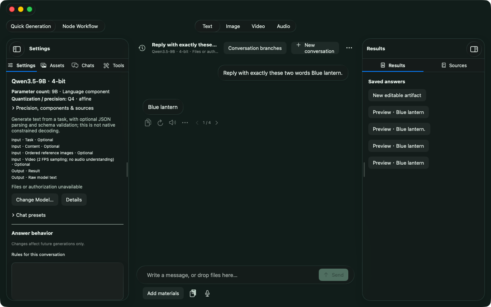

Choose a model and chat preset on the left, then write in the input area below the conversation. Use the message tools to copy an answer. Use the Sources panel to inspect source materials or open “View sent content and settings” for that answer.

### Quick Generation

Switch between image, video and audio, choose a model, enter your creative brief and add supported inputs or adjust settings. View, play, save and export results from the same workspace.

**Images.** Supported models can generate images from text and reference pictures.

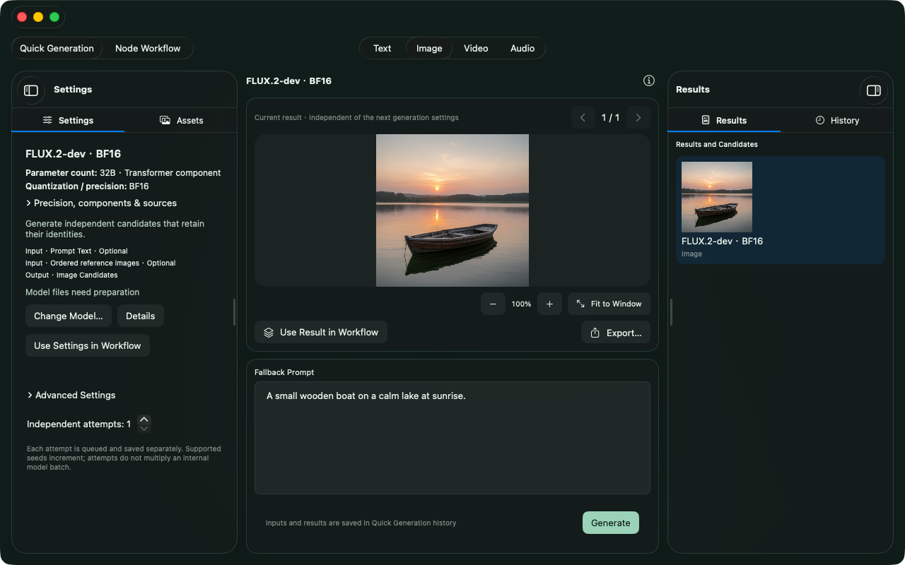

Choose the model and settings on the left and describe the image below the preview. The center shows a saved generated image. Choose a result on the right and use the controls below the preview to export it or continue in a workflow.

**Video.** Depending on the model, start from text, a first frame, or first and last frames.

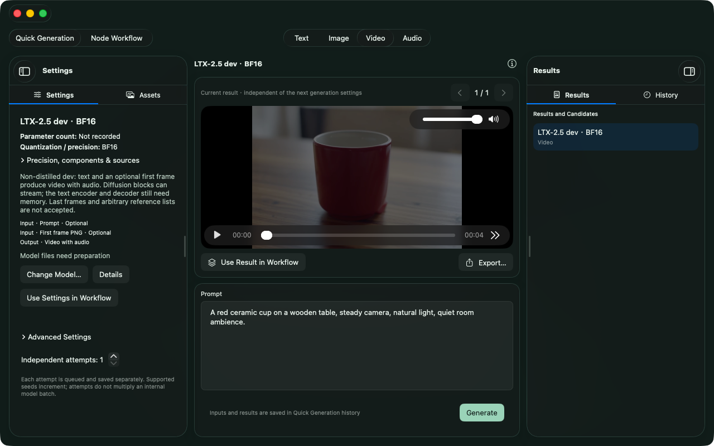

The video workspace brings the supported inputs and settings together with a central player. Select a saved output on the right to preview or export it.

**Audio.** In Quick Generation, MRT2 creates music from text, while ACE offers instrumental music or music with lyrics. Reference audio and more complex audio inputs remain available in node workflows for models that support them.

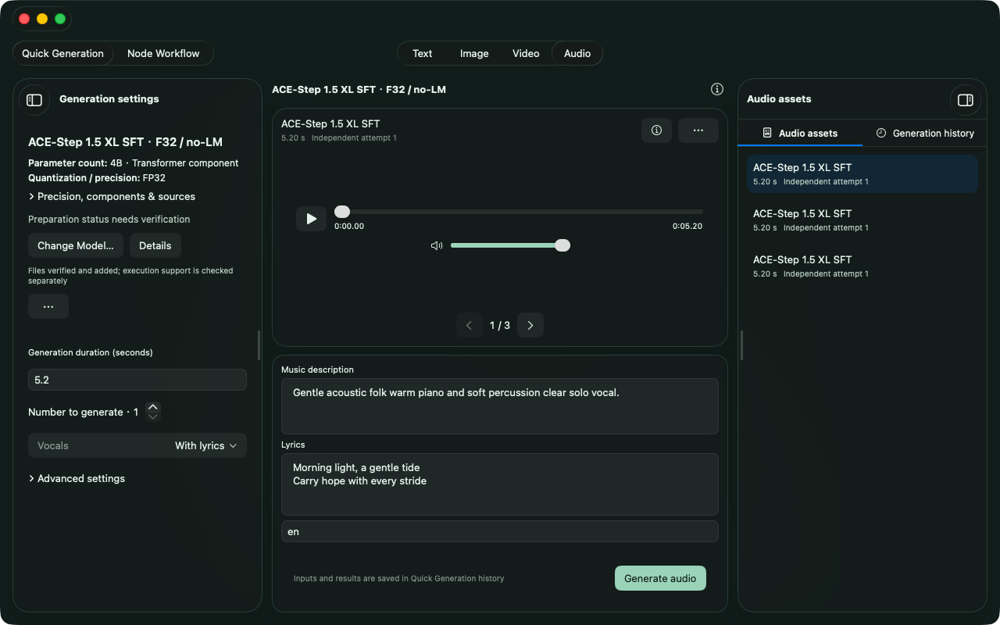

Set up the model on the left and enter a music description, plus lyrics when applicable, below the player. Select an audio candidate on the right to listen to it or save it for later.

### Node workflows

When a creation needs several steps, switch to the node workspace. Add models and processing steps to the canvas, connect their inputs and outputs, and configure each step.

You can inspect candidates along the way, choose what to use and continue with the next steps. Save a useful workflow to use again later.

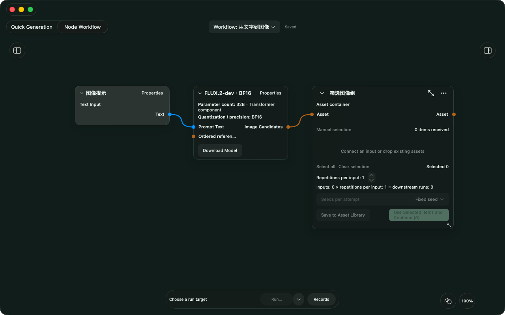

Connect a text input to an image model and then to a selection step. Open a node's properties to configure it; select the run target and start from the bar below the canvas.

## Choose results, then keep creating

Compare candidates before deciding which to use. Completed content is retained when a later step fails.

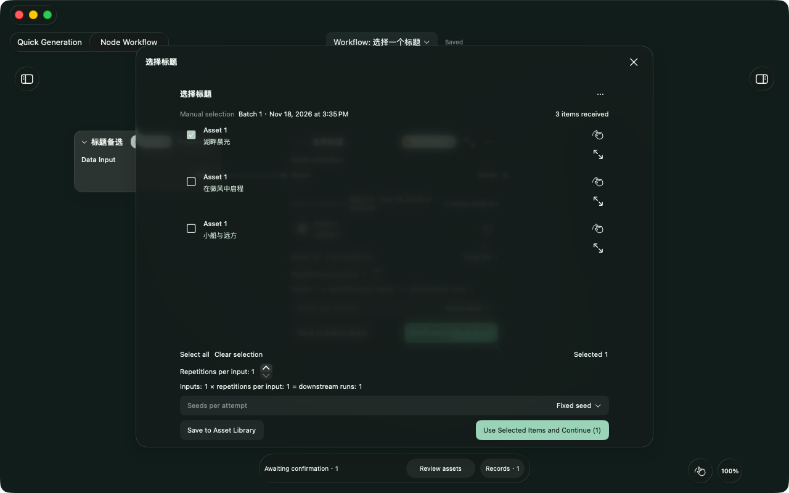

Compare the available titles before choosing which to use. Check the items you want, then save them to the asset library or use the selected items to continue the workflow.

Viewing a run leaves its recorded workflow unchanged. While a workflow is running, the first actual edit creates a working copy. To edit an asset in another application, explicitly open an independent copy.

The library helps you find and reuse content. The viewer lets you inspect images, play audio and video, or read text.

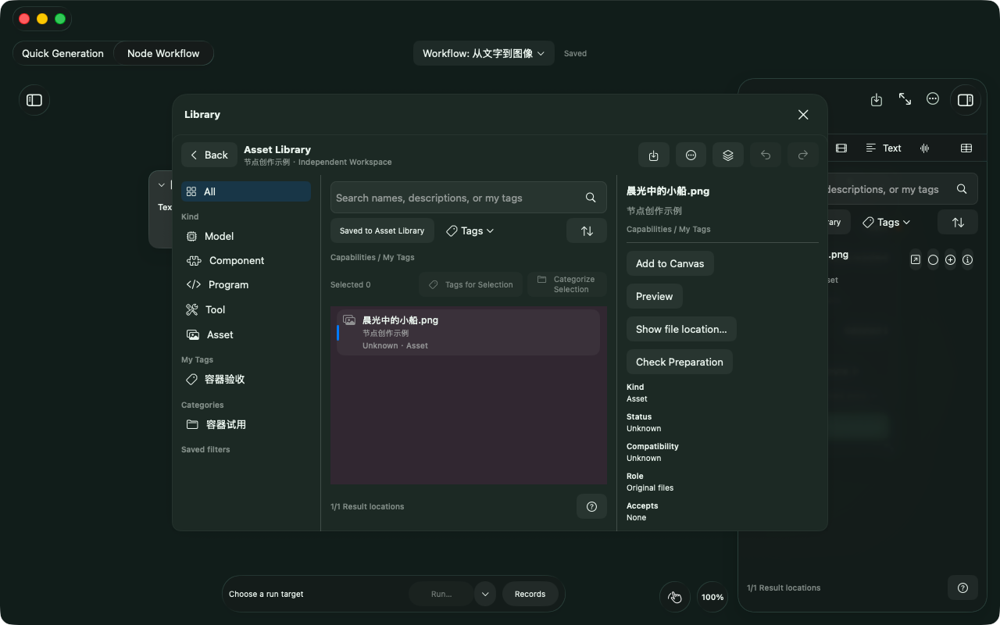

Search or filter the library, then select an item to inspect its details. Use the available controls to preview the item or add it to the canvas.

Projects organize related workflows, settings and content. Save a project to reopen it and continue. Project file tools show file locations and provide backup and restore options, including choices for external files and models.

## Add the models you want to use

D includes **no model weights**. Open **Model Manager** to add supported models, and use **Download Manager** to follow downloads. Both are available from the Window menu.

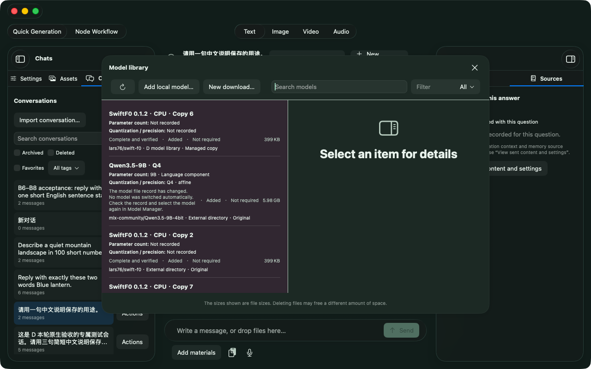

Use the local model entry to add files you already have, or start a download. The list shows the models and their current availability; preparation may still be needed before a model can run.

When adding local files, choose from the options offered for that model:

- **Use the original files directly:** keep the model in its existing location, where D reads it.
- **Copy to model library:** use an independent copy while retaining the original files.

D checks the files and shows download or preparation progress. Once a model is ready, you can select it for chat, Quick Generation or a workflow.

For models that support a low-memory mode, D can offer that approach before starting. It takes longer and requires your agreement unless you have chosen to remember the preference. D keeps the exact model and precision you selected.

## Your first creation

1. Open Model Manager and download or add a supported model. Follow downloads in Download Manager.
2. Enter chat, or choose image, video or audio in Quick Generation.
3. Select the model, provide the inputs and start generating.
4. Inspect the result, then save, export or use it in a later workflow.

## Requirements and current progress

D is designed for **Apple silicon Macs**. The current development version requires **macOS 26.2 or later**. Model availability and generation speed depend on model size, memory and disk space. Model files need additional storage; check the displayed download size before starting.

Chat, Quick Generation, node workflows, model management, and project and result saving and recovery are already implemented. Work continues on remaining issues, interface checks and release preparation.

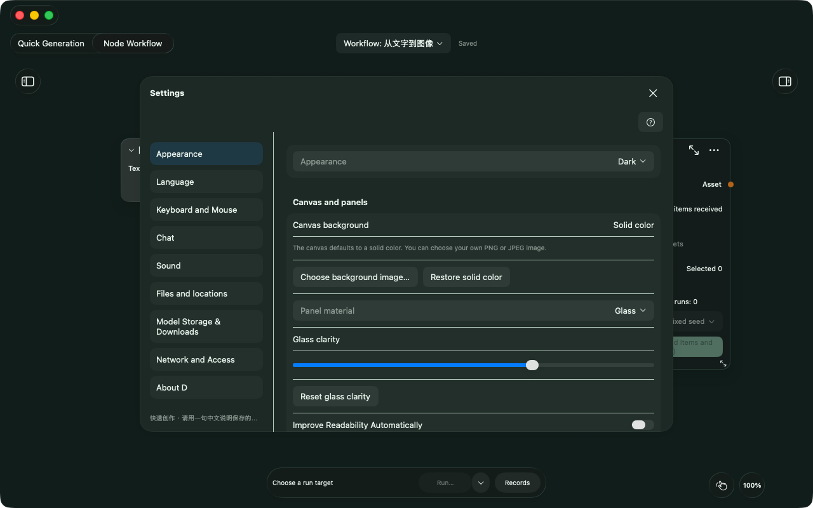

Open Settings to adjust appearance, language and other application preferences. Categories on the left keep these choices separate from the settings of an individual conversation or workflow.

See the [model capability matrix](docs/RELEASE_MODEL_MATRIX.zh-CN.md) for supported capabilities and the [current development status](docs/CURRENT_ACTIONS.zh-CN.md) for progress and remaining work. These technical references are maintained in Simplified Chinese.

## Free to use, with voluntary support

D itself is free. Voluntary tips will let you support continued development. A public installer and the tipping service will become available after release preparation is complete.

## Development, feedback and licensing

For development resources and build guidance, see [Development](Development/README.md) and the [repository guide](docs/REPOSITORY_MAP.zh-CN.md).

You can currently report problems through [GitHub Issues](https://github.com/lfrledh/D/issues). Include concise steps and your Mac's macOS version, chip and memory. Remove private content before sharing screenshots or logs. A dedicated public support address has not yet been established.

The license for D's own code is **not yet decided**. Third-party components retain their respective licenses; see [Vendor provenance](Vendor/README.md) and the license and notice files alongside the relevant components.

[Back to top](#d-english) · [简体中文](#d-chinese)

---

# D — Mac 本地 AI 创作工作台

[English](#d-english) · **简体中文**

D 让你在 Mac 上使用文字、图像、视频和音频模型进行创作。你可以从一次对话或一次生成开始，也可以把多个步骤连接成工作流，逐步查看结果、作出选择，再继续处理。

当前为**开发预览，尚未提供公开安装包**。D 仍是开发代号，正式名称待定。

[开始创作](#zh-create) · [选择与复用结果](#zh-results) · [添加模型](#zh-models) · [第一次开始](#zh-start) · [运行环境](#zh-progress) · [支持与开发](#zh-support)

以下截图来自当前开发版，使用简体中文界面。

## 从你想做的事情开始

### 聊天与写作

选择本地文字模型，通过对话提问、整理内容或修改文稿。需要结合图片和文件时，可在支持相应输入的模型中添加附件。常用设置可以保存为**聊天预设**，之后再次使用。

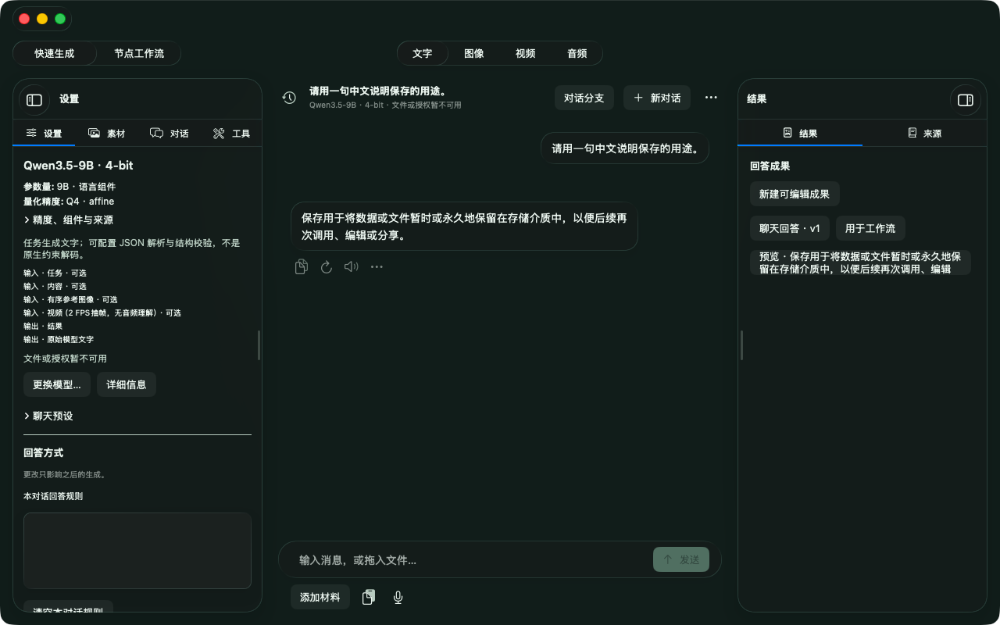

从左侧选择模型和聊天预设，在对话下方输入消息。通过消息工具复制回答；右侧结果页可查看已保存内容，来源页可查看来源材料，并通过“查看这次发送的内容与设置”打开这次回答的请求详情。

### 快速生成

在图像、视频和音频之间切换，选择模型，输入创作要求，并按需要添加参考素材或调整参数。生成结果可以直接查看、播放、保存和导出。

**图像。** 支持相应输入的模型可以根据文字和参考图生成图片。

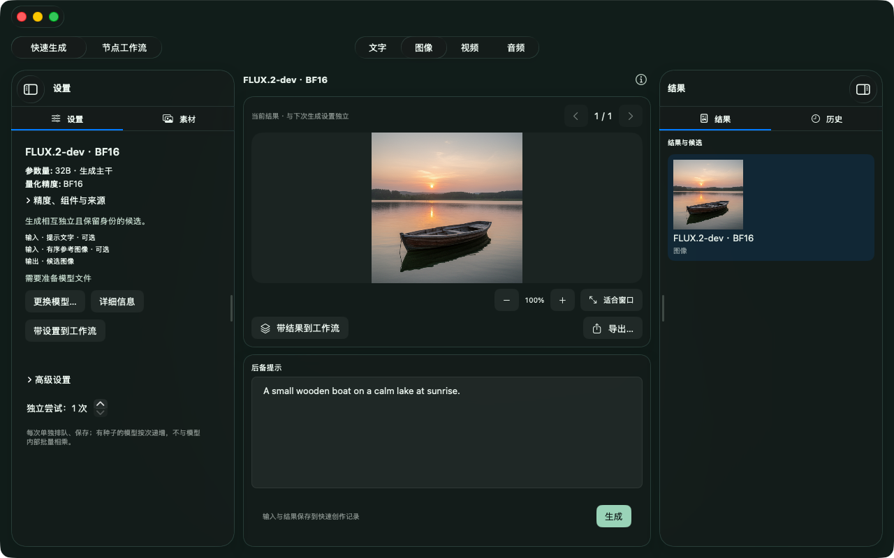

在左侧选择模型和参数，在预览下方描述想生成的图像。中央展示已保存的生成结果。在右侧选择结果，通过预览下方的操作导出或继续用于工作流。

**视频。** 根据所选模型，可以使用文字、首帧或首尾帧生成视频。

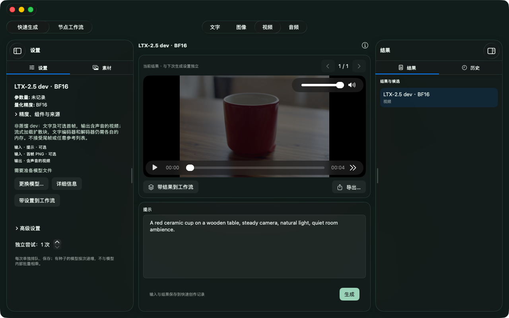

视频工作区将可用输入、参数和中央播放器放在一起。从右侧选择已保存的输出，即可预览或导出。

**音频。** 快速生成中的 MRT2 提供文字生成音乐，ACE 提供纯音乐或含歌词的生成方式。参考音频及复杂音频输入保留在支持这些能力的节点工作流中。

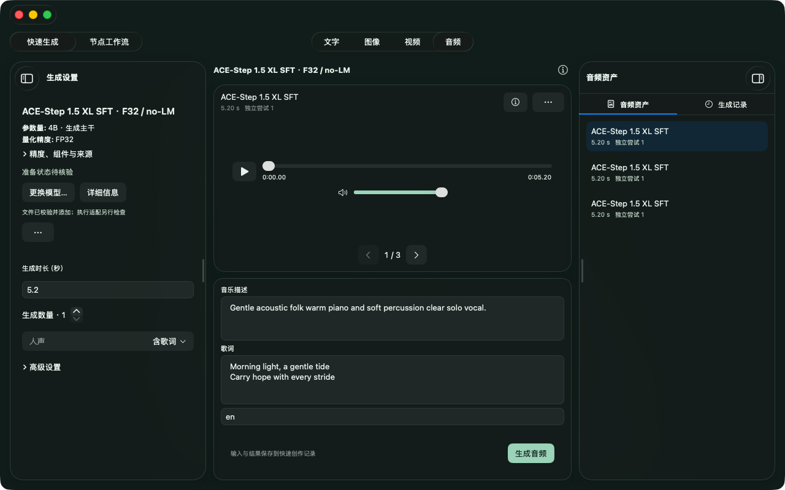

在左侧设置模型，在播放器下方填写音乐描述，并在适用时填写歌词。从右侧选择音频候选，试听或保存需要的内容。

### 节点工作流

需要组合多个步骤时，切换到节点工作流。在画布上添加模型或处理步骤，连接它们的输入和输出，并分别设置参数。

你可以在中间查看生成的候选结果，选择要采用的内容，再继续后面的步骤。常用流程可以保存，以后再次使用。

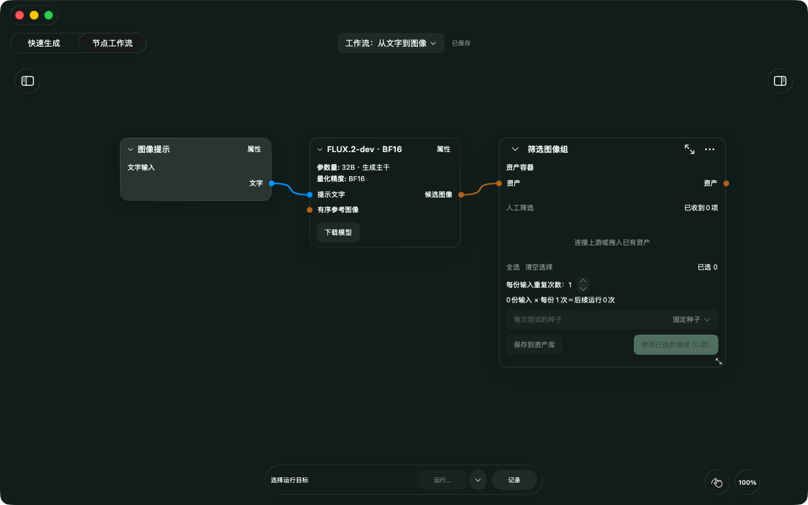

将文字输入连接到图像模型，再连接筛选步骤。打开节点属性进行配置，在画布下方选择运行目标并开始运行。

## 选择结果，再继续创作

生成多个候选后，可以先比较内容，再决定采用哪些结果。已经完成的内容会保留，后续步骤失败不会让前面的结果一起消失。

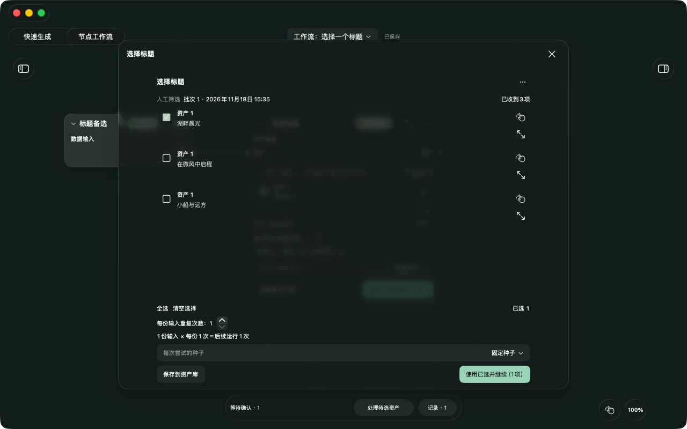

比较可选的标题，决定采用哪些内容。勾选要使用的内容后，可以保存到资产库，或使用已选内容继续工作流。

查看运行结果不会改写记录中的原流程；运行期间首次实际修改当前工作流时，D 会创建编辑副本。需要在外部应用中编辑资产时，可明确打开独立副本。

资料库用于查找和复用素材，预览界面用于查看图片、播放音视频或阅读文字。

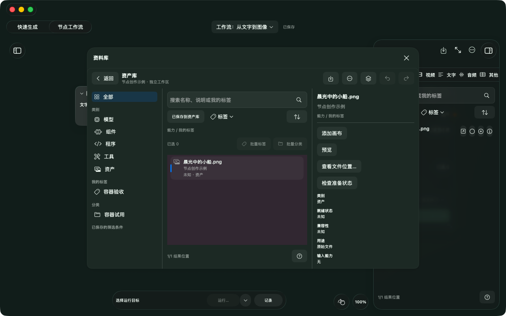

先搜索或筛选，再选择条目查看详情。通过相应操作预览内容，或将它添加到画布。

项目将相关工作流、设置和内容组织在一起。保存项目后，可以重新打开继续处理，也可以通过项目文件与备份功能查看文件位置、备份和恢复，并选择如何处理外部文件和模型。

## 添加你要使用的模型

D **不附带模型权重**。可以从“窗口”菜单打开“模型管理”，添加 D 支持的模型；“下载管理器”用于查看下载进度。

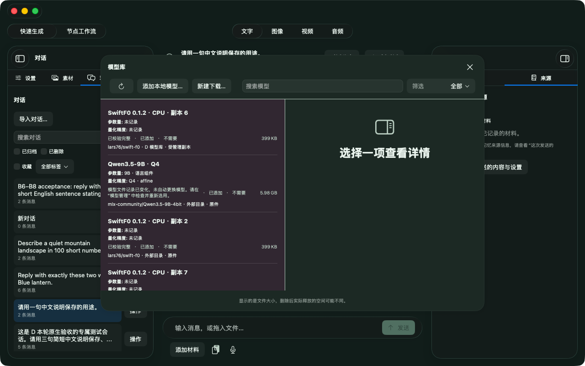

从添加本地模型入口选择已有文件，或发起新的下载。列表显示模型及其当前状态，需要准备的模型会继续显示相应步骤。

添加本地文件时，根据界面提供的选项选择：

- **直接使用原文件：** 模型留在原位置，D 从那里读取。
- **复制到模型库：** D 保存一份独立副本，原文件保留。

添加过程中，D 会检查模型文件，并显示下载或准备进度。模型可用后，就可以在对话、快速生成或工作流中选择使用。

对支持低内存运行的模型，D 可以在开始前提供这种方式，代价是更长的等待时间。默认需要你同意；也可以主动记住选择。D 保留你选定的准确模型和精度。

## 第一次开始

1. 打开“模型管理”，下载或添加一个 D 支持的模型；下载进度可在“下载管理器”查看。
2. 进入聊天，或选择图像、视频、音频中的一种快速生成方式。
3. 选择模型，填写输入并开始生成。
4. 查看结果，保存、导出，或加入后续工作流。

## 运行环境与当前进展

D 面向搭载 **Apple 芯片的 Mac**，当前开发版需要 **macOS 26.2 或更新版本**。实际可用模型和生成速度取决于模型规模、Mac 内存和磁盘条件；模型文件需要额外空间，下载前可查看所需容量。

当前已经具备聊天、快速生成、节点工作流、模型管理，以及项目和结果的保存与恢复能力。项目正在完成剩余问题修正、界面体验检查和发行准备。

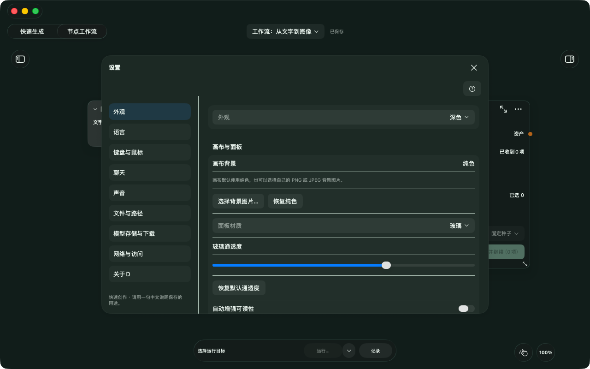

打开设置，可调整外观、语言及其他应用偏好。左侧分类将这些选项与某个对话或工作流自身的设置分开。

模型能力的详细范围见[模型能力矩阵](docs/RELEASE_MODEL_MATRIX.zh-CN.md)，最新开发进展见[当前行动](docs/CURRENT_ACTIONS.zh-CN.md)。

## 免费使用与支持开发

D 本体免费。你可以通过自愿打赏支持后续开发。正式安装包与打赏服务将在发行准备完成后提供。

## 开发、反馈与许可

开发者可通过现有[开发资源说明](Development/README.md)和[仓库导航](docs/REPOSITORY_MAP.zh-CN.md)了解构建方法。

目前可通过 [GitHub Issues](https://github.com/lfrledh/D/issues)反馈问题，附上简短步骤及 Mac 的系统版本、芯片和内存信息。分享截图或日志前请移除私人内容。专用公开支持地址尚未建立。

D 自有代码的许可证尚未确定。第三方组件保留各自许可证，见 [Vendor 来源说明](Vendor/README.md)及对应组件目录中的许可证与声明文件。

[返回顶部](#d-chinese) · [English](#d-english)
